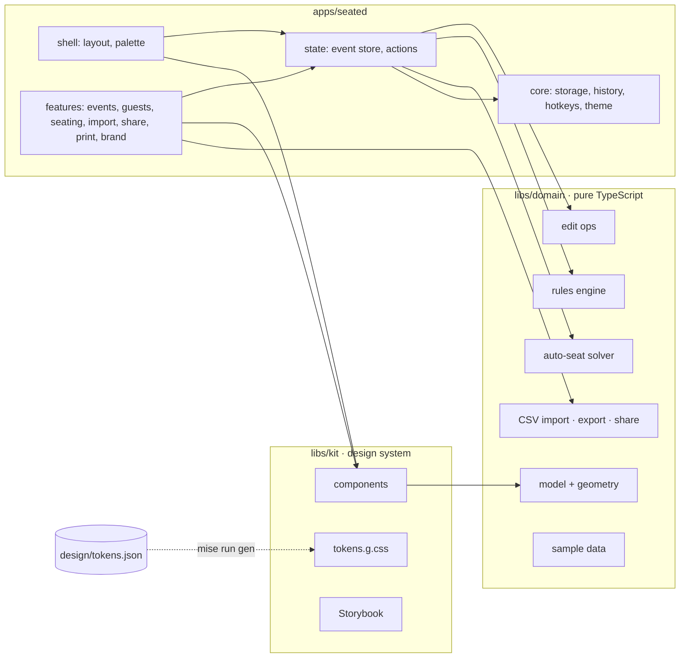

# Architecture

Layers only point down: `apps` uses `libs/kit` and `libs/domain`; `libs/kit` uses only pure geometry from `libs/domain`; `libs/domain` imports nothing. ESLint's `no-restricted-imports` enforces this per folder.

## Domain

`libs/domain` is framework-free TypeScript. Every value is plain, readonly JSON, so storage, export files and undo snapshots are all the same shape.

- **Model.** `SeatingEvent` holds groups, parties, guests, tables, rules and the floor plan. A guest's seat is a `SeatRef` (`tableId`, `index`), so there is one source of truth for who sits where.
- **Geometry.** `seatPositions` and `tableTop` describe the three table shapes. The kit draws tables from them and the rules engine uses them to decide what counts as "near the exit".
- **Ops.** Every edit is a pure function `(event, ...) => OpResult`: a new event or a typed failure (`no-room`, `occupied`, `not-found`, `invalid`, `duplicate`). Ops never mutate and reuse unchanged parts of the event, so snapshots are cheap.
- **Rules.** `evaluate(event)` checks keep-apart, keep-together, near-exit and the implicit capacity of every table, and reports each as `met`, `waiting` or `conflict`. See [rules-and-solver.md](rules-and-solver.md).
- **Solver.** `autoSeat(event)` fills empty seats without creating a conflict and explains itself.
- **Formats.** CSV parse and column mapping, row validation and duplicate merging; a versioned export file with a migration table; a compressed share payload that carries names and tables only.
- **Text.** The domain returns codes and names, never sentences. The app phrases them with `$localize` in `apps/seated/src/app/i18n/messages.ts`.

## Kit

`libs/kit` is the design system. Tokens are generated from `design/tokens.json` into CSS custom properties (`--st-*`) for light and dark. Components are standalone, `OnPush`, signal-based and take plain view models such as `SeatView`, never domain entities. Each has a spec and Storybook stories; interactive stories carry `play` functions that run as tests with an axe scan in both themes.

## App

- **Zoneless, signals throughout.** No zone.js. State is signals and `computed`; templates use the built-in control flow.
- **Routing.** Every screen is a lazy route. `withComponentInputBinding` binds route and query params straight to component inputs, so a filtered guest list or an open guest panel is a shareable URL.
- **State.** `EventStore` (NgRx SignalStore) holds the open event. Feature screens keep view-only state in their own stores. Every change is a `Command` (`label` plus a pure op) run through `Actions.run`, which applies it, records it, shows a toast with Undo and announces it to screen readers.
- **History.** `withHistory()` is a reusable SignalStore feature: `commit(label, next)`, `undo()`, `redo()`. It stores before and after snapshots, which share structure, so 100 steps cost little.
- **Storage.** `EventRepository` is an interface with an IndexedDB implementation in the browser and an in-memory one for tests and prerendering. Saves are optimistic: the UI changes first and the write follows, with a saved indicator in the sidebar.
- **Shortcuts.** One document listener (`Hotkeys`) with stacked bindings, so an open dialog can take Escape from the page beneath it.
- **Command palette.** Screens register commands while they are open; the shell owns navigation, history and theme.

## Platform

- **PWA.** The Angular service worker caches the app shell and fonts, so everything works offline after the first visit.
- **Prerendering.** The landing route and the public share page are prerendered; the share page reads everything from the URL hash.
- **Locale.** The source locale is `en-IN`: dates read "Fri 18 Dec" and numbers group as 1,00,000.
